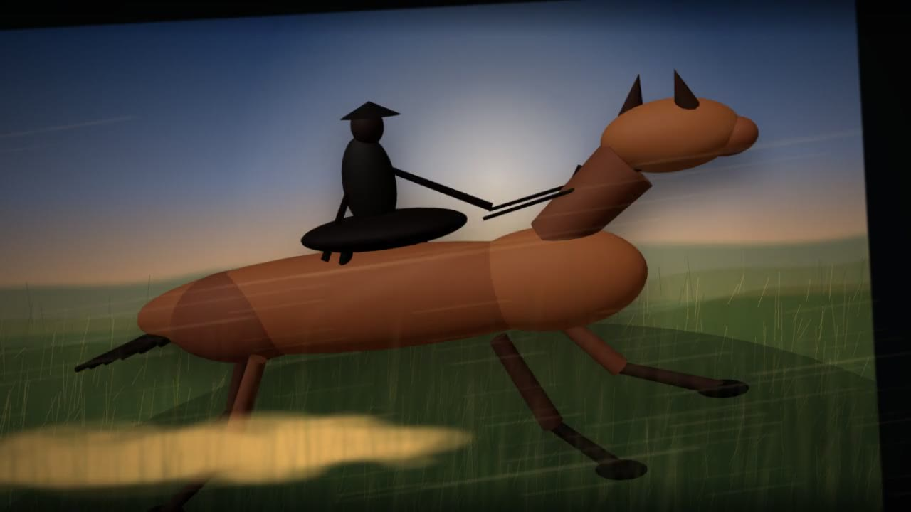

[English](README.md) | **简体中文**

<p align="center"></p>
<h1 align="center">Horse Video</h1>
<p align="center"><strong>十五秒电影感奔马，逐帧用 TypeScript 画出来。</strong></p>
<p align="center"><sub>夕阳下，一匹低多边形马载着戴斗笠的骑手——React · Three.js · SVG · Remotion，不用时间线编辑器，不导入角色绑定。</sub></p>

<p align="center">
  <a href="LICENSE"></a>
  <a href="docs/project-status.md"></a>
</p>

<p align="center"><a href="render/horse-run-remotion.mp4"></a></p>
<p align="center"><sub>成片中的一帧，取自仓库里的 MP4——点一下就能看。</sub></p>

一位戴斗笠的骑手策马跑过夕阳下被风吹动的原野。每一根草、每一粒尘、步态、镜头推进与调色都由代码生成，同样的输入永远得到同一部片子，而整个场景仍然是一份可读、可改的 TypeScript 源码。

## ▶ 先看成品

仓库里已附渲染结果：**[render/horse-run-remotion.mp4](render/horse-run-remotion.mp4)**
（1280×720，30 fps，15 秒，H.264 / YUV 4:2:0，立体声 AAC）。直接打开或下载即可，它就是下面这些命令的产物。上方静帧正是从这个文件里截出来的。

## ⚡ 快速开始

需要 Node.js 18+ 与 npm，依赖版本由 `package-lock.json` 锁定。

```bash
npm ci
npm run studio
```

`remotion studio --no-open` 会启动本地 Studio 并打印地址，打开它就能拖动预览 `HorseRun` 合成。要生成 MP4：

```bash
npm run render   # 输出到 render/horse-run-remotion.mp4
```

## ✨ 目前能做什么

- **一条命令，一部短片。** 450 帧、1280×720、30 fps，导出为 H.264 / YUV 4:2:0。
- **用基本几何体搭出的低多边形马与骑手。** 椭球躯干、颈与头，锥形耳朵，一顶斗笠，四条带关节的腿跑出四拍步态，加上缰绳线与接地阴影——全部是 Remotion `<ThreeCanvas>` 里的 Three.js 几何。
- **程序化场景。** 900 根远景草、620 根近景草、170 粒尘土，加上随风摆动与被风吹动的层次，全部由固定随机种子生成，多次渲染结果一致。
- **可编程的摄影。** 镜头环绕、跟拍横移、马蹄落地时的抖动、翻滚、景深呼吸、夕阳眩光与调色，都是普通常量与缓动曲线。
- **自带声音。** 渲染时混入 `public/audio/horse-run-remotion-audio.wav`。
- **同一个文件里还有一部长得多的戏。** `HuaqiangMelon`：2100 帧（约 70 秒）的街头小品，有集市布景、人物、中文字幕、21 条人声和独立音效时间线。它**没有**注册进 `src/Root.tsx`，接上之前无法渲染。

## 🧭 结构

| 路径 | 作用 |
| --- | --- |
| `src/index.ts` | 注册 Remotion 根节点。 |
| `src/Root.tsx` | 声明 `HorseRun` 合成：450 帧、30 fps、1280×720。 |
| `src/HorseRun.tsx` | 场景本体：带种子的景物、三维马匹、镜头、调色、音频，以及未注册的 `HuaqiangMelon`。 |
| `public/audio/` | 音轨，以及只被 `HuaqiangMelon` 使用的人声与音效素材。 |
| `render/` | `npm run render` 的已提交输出。 |
| `assets/` | 本文顶部使用的静帧。 |
| `remotion.config.ts` | JPEG 帧、覆盖输出、H.264、`yuv420p`。 |
| `logo.svg` | 上方使用的标志。 |

由远及近的层次：`Background`（天空渐变、夕阳辉光、三条视差山脊）→ `GrassField` → `ThreeHorseRig`（主角）→ `HeroDustAndWind` → `ForegroundGrass` → `CameraAndFx`（速度线、眩光、暗角）。同一套镜头变换——由帧号算出的缩放、位移与翻滚——包住整摞图层，所以每一层都一起动。

有两处遗留值得知道。`src/HorseRun.tsx` 里的 `HorseRig` 与 `DustSystem` 是早期的纯 SVG 马，当前这一版已经不再挂载；`HuaqiangMelon` 存在，但没有对应的 `<Composition>` 条目。两者都刻意保留而非删除，也都写进了路线图。

## 🛠 开发

| 命令 | 作用 |
| --- | --- |
| `npm ci` | 安装锁定后的依赖。 |
| `npm run studio` | 启动 Remotion Studio 并打印本地地址。 |
| `npm run render` | 将 `HorseRun` 渲染到 `render/horse-run-remotion.mp4`。 |
| `npm run typecheck` | 用 `tsc --noEmit` 检查 `src/`。 |

调参就是改 `src/HorseRun.tsx` 里的常量与 `interpolate` 区间：步态速度、镜头路径、草地密度、氛围、调色。替换音轨时保持 `staticFile` 路径不变；要剪新片，就在 `src/Root.tsx` 再加一个 `<Composition>`。渲染比较吃 CPU；仓库里的 MP4 是参考输出，不是读懂代码前必须先重建的产物。

## 🤝 参与贡献

见 [CONTRIBUTING.md](CONTRIBUTING.md)。欢迎聚焦的视觉改进、性能修复和文档修正。提交时请不要带上缓存或无关媒体，并在 PR 里说明画面上的变化。

## 🗺 路线图

**已完成**

- `HorseRun`：15 秒奔跑场景，包含程序化草地、尘土、速度线、三维马与骑手、镜头、调色与音频。
- `HuaqiangMelon`：2100 帧的完整集市场景，含字幕与声音，已写好但尚未注册。
- 带种子的确定性生成，重复渲染结果一致。
- 已提交的 1280×720 / 30 fps MP4、一张静帧，以及可复现的 `npm run render` 路径。
- 项目文档：[状态](docs/project-status.md)、[更新日志](CHANGELOG.md)、[贡献指南](CONTRIBUTING.md)、[安全说明](SECURITY.md)。

**计划中（暂缓，不作承诺）**

- 为 `HuaqiangMelon` 做一个小的合成选择器并注册进 `src/Root.tsx`，让两部戏都从一个入口渲染。
- 让 SVG 的 `HorseRig` / `DustSystem` 复活，或者正式退役——等确定项目要哪匹马之后再说。
- 抽出可复用的场景参数，但只在第三个动画确实需要时才做。

这个项目有意只做一个已完成的艺术实验，而不是框架。若继续生长，最自然的方向是一小组共享同一套程序化景物手法的电影感短片：每部自成一体，每部都能作为源码逐行读懂，也都不依赖时间线编辑器。

## 许可证

Copyright (C) 2026 ZisIsNotZis。源代码采用 [AGPL-3.0-only](LICENSE) 授权。重新分发渲染成品前，请先确认媒体与字体的来源与授权。
